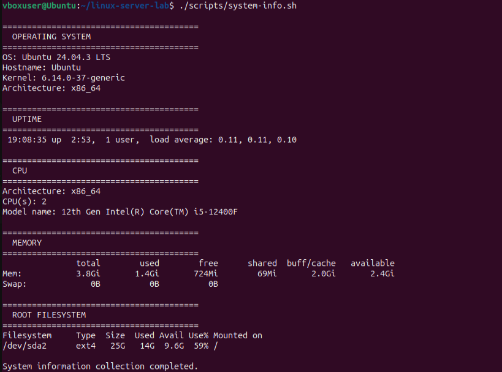
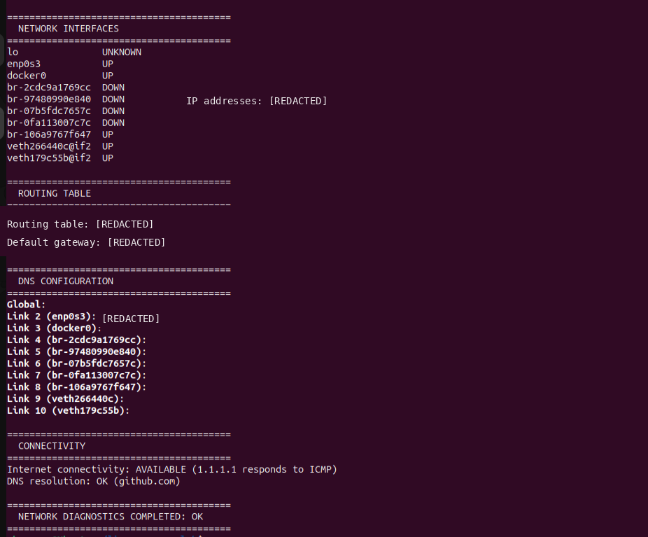
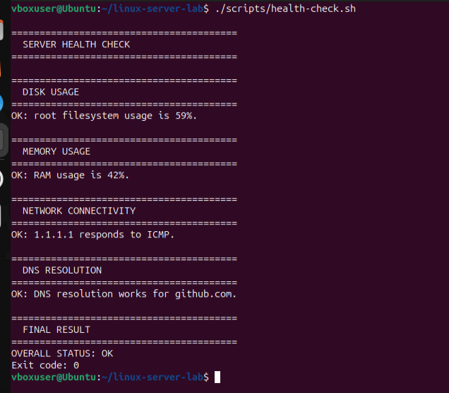

# Linux Server Lab

[](https://github.com/bog2003112/linux-server-lab/actions/workflows/ci.yml)


**Linux Server Lab** is a hands-on Linux system administration project focused on Bash automation, server health monitoring, and network diagnostics.

The project is developed and tested on **Ubuntu 24.04 LTS**. It demonstrates practical Linux administration skills through custom diagnostic scripts, configurable health checks, and automated code validation with GitHub Actions.

This is an educational portfolio project built incrementally with a focus on clean scripting, reliability, and maintainability.

## Features

### 1. System Information

`system-info.sh`

Collects and displays:
- Operating system and distribution version.
- Hostname and kernel version.
- CPU architecture and processor information.
- System uptime and load average.
- RAM and swap usage.
- Root filesystem utilization.

### 2. Network Diagnostics

`network-info.sh`

Provides information about:
- Network interfaces and IP addresses.
- Routing table and default gateway.
- DNS configuration.
- Internet connectivity using ICMP.
- DNS resolution checks.

### 3. Server Health Monitoring

`health-check.sh`

Performs automated health checks for:
- Disk utilization.
- Memory utilization.
- Network connectivity.
- DNS resolution.

Supports configurable warning and critical thresholds.

## Technology Stack

| Technology | Purpose |
|---|---|
| Ubuntu 24.04 LTS | Operating system |
| Bash | Automation and diagnostic scripts |
| Linux CLI | System administration |
| iproute2 | Network diagnostics |
| SSH | Remote server access |
| Git | Version control |
| GitHub | Source code management |
| GitHub Actions | CI automation |
| ShellCheck | Bash static analysis |

## Project Structure

```text
linux-server-lab/
├── .github/
│   └── workflows/
│       └── ci.yml
├── docs/
│   ├── linux-basics.md
│   ├── networking.md
│   └── ssh.md
├── scripts/
│   ├── system-info.sh
│   ├── network-info.sh
│   └── health-check.sh
├── screenshots/
└── README.md
```

## Installation

Clone the repository:

```bash
git clone https://github.com/bog2003112/linux-server-lab.git
cd linux-server-lab
```

Make scripts executable:

```bash
chmod +x scripts/*.sh
```

Install required utilities if they are missing:

```bash
sudo apt update
sudo apt install -y iproute2 iputils-ping
```

## Usage

Run system information collection:

```bash
./scripts/system-info.sh
```

Run network diagnostics:

```bash
./scripts/network-info.sh
```

Run server health monitoring:

```bash
./scripts/health-check.sh
```

## Health Check Configuration

The health monitoring script supports configurable thresholds through environment variables.

Default thresholds:

| Metric | Warning | Critical |
|---|---:|---:|
| Disk usage | 80% | 90% |
| Memory usage | 80% | 90% |

Example: change disk thresholds:

```bash
DISK_WARN_THRESHOLD=75 \
DISK_CRIT_THRESHOLD=90 \
./scripts/health-check.sh
```

Change memory thresholds:

```bash
MEMORY_WARN_THRESHOLD=70 \
MEMORY_CRIT_THRESHOLD=85 \
./scripts/health-check.sh
```

Configure connectivity targets:

```bash
PING_TARGET=1.1.1.1 \
DNS_TARGET=github.com \
./scripts/health-check.sh
```

Warning thresholds must be lower than critical thresholds. Values must be integers between 1 and 100.

### Exit Codes

The health check returns monitoring-friendly exit codes:

| Exit Code | Status | Description |
|---|---|---|
| `0` | OK | All checks passed |
| `1` | WARNING | A warning threshold was exceeded |
| `2` | CRITICAL | A critical threshold or connectivity check failed |
| `3` | UNKNOWN | A metric could not be read or configuration is invalid |

These exit codes allow the script to be integrated into monitoring and automation workflows.

**Note:** ICMP traffic may be blocked by some networks. A failed ping does not necessarily mean that the internet connection is unavailable.

## Continuous Integration

The project uses **GitHub Actions** for automated Bash validation.

The CI workflow runs on pushes and pull requests.

Current pipeline:

1. Checkout repository.
2. Install ShellCheck.
3. Validate Bash syntax using `bash -n`.
4. Analyze scripts using ShellCheck.

All checks must pass for the workflow to complete successfully.

[View GitHub Actions](https://github.com/bog2003112/linux-server-lab/actions)

## Design Principles

- Read-only diagnostics: scripts collect information without modifying host configuration.
- Configurable monitoring thresholds.
- Explicit exit codes for automation.
- Bash syntax validation.
- Static analysis with ShellCheck.
- Incremental development and version control.
  
## Screenshots

### System Information
Displays operating system, CPU, memory, uptime, and disk usage.



### Network Diagnostics
Displays network interface diagnostics, routing checks, and connectivity status.



### Server Health Check
Displays disk and memory monitoring, connectivity checks, and overall health status.




## Roadmap

Planned development milestones:

- [x] Linux system information collection.
- [x] Network diagnostics.
- [x] Server health monitoring.
- [x] Configurable warning and critical thresholds.
- [x] Bash syntax validation.
- [x] ShellCheck integration.
- [x] GitHub Actions CI pipeline.
- [ ] Docker containerization.
- [ ] Docker Compose deployment.
- [ ] Nginx web server configuration.
- [ ] Container health monitoring.
- [ ] Extended CI/CD automation.

## Project Status

**Active development.**

This repository is a practical Linux system administration and DevOps learning project. New infrastructure components and automation capabilities will be added incrementally.

---

**Author:** Bogdan Gareev

**GitHub:** [@bog2003112](https://github.com/bog2003112)

**Repository:** [Linux Server Lab](https://github.com/bog2003112/linux-server-lab)****
